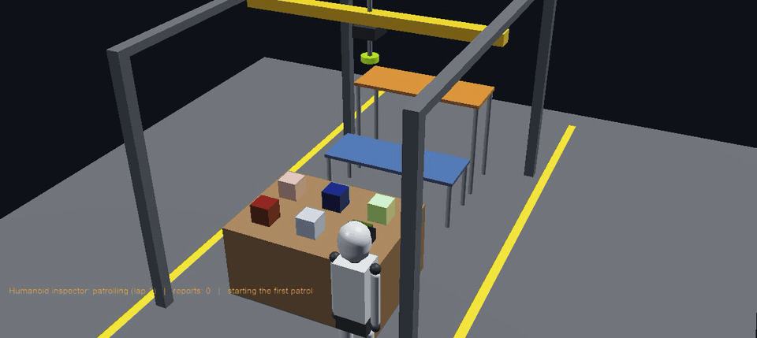
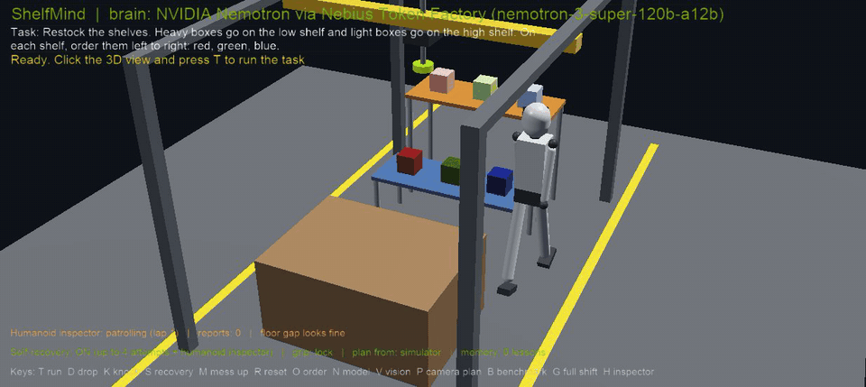
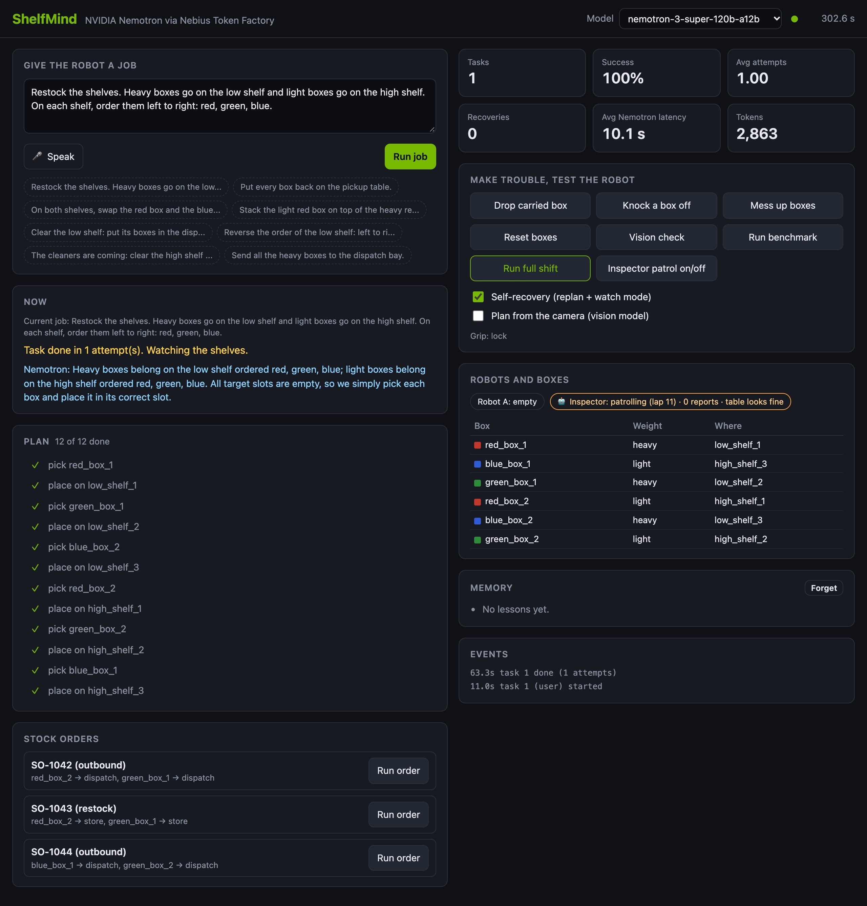
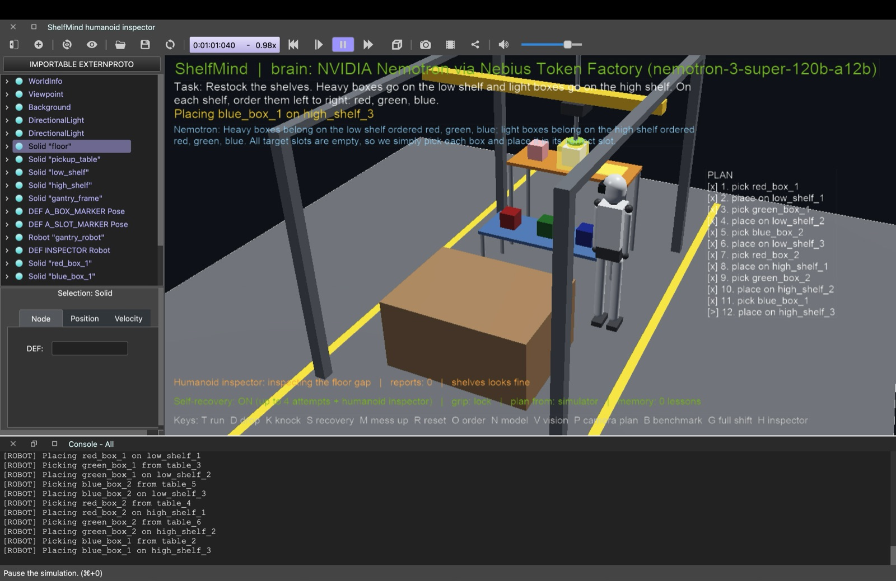
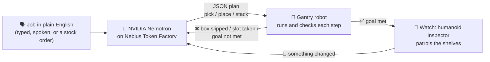

<div align="center">

# ShelfMind

### A stockroom robot that understands plain English, notices its own mistakes, and fixes them.

**Brain: NVIDIA Nemotron · Served by Nebius Token Factory · Simulated in Webots**

[](https://www.nvidia.com/en-us/ai-data-science/foundation-models/nemotron/)
[](https://nebius.com/token-factory)
[](https://cyberbotics.com)
[](#-quick-start)
[](LICENSE)



*Real footage: Nemotron plans the restock, a box slips out of the gripper, Nemotron replans, the robot finishes the job.*

</div>

---

## ✨ The idea in 20 seconds

Warehouse robots are great at following scripts and terrible at surprises. A box slips, someone bumps a shelf, an order changes, and the script breaks until a human steps in.

**ShelfMind puts a reasoning model in the loop.** You give the robot a job in plain English. **NVIDIA Nemotron** turns it into a step-by-step plan. The robot carries it out and **checks every step**. When reality doesn't match the plan, it tells Nemotron exactly what went wrong, gets a new plan, and fixes it by itself. When the job is done, a **humanoid inspector** keeps patrolling the stockroom and reports anything that changes.

> "Restock the shelves. Heavy boxes go on the low shelf and light boxes go on the high shelf. On each shelf, order them left to right: red, green, blue."
>
> That is the whole program.

---

## 🏆 Results with real Nemotron

Every number below comes from real runs against **Nemotron on Nebius Token Factory**. The full log of the 12-step shift is in [`docs/evidence/nemotron_full_shift.jsonl`](docs/evidence/nemotron_full_shift.jsonl).

| What we measured | Result |
|---|---|
| **Full working shift** (12 jobs and incidents in a row, plain English only) | ✅ **12 / 12 steps passed** |
| Plans written by Nemotron vs. fallback rules | **12 / 12 by Nemotron**, 0 fallbacks |
| Average planning time (Nemotron 3 Super 120B) | **5.8 s** per plan |
| Tokens for the whole shift | **≈ 29,000** |
| Recovery from a box slipping mid-carry | ✅ replanned and finished |
| Knocked-off box found by the humanoid inspector | ✅ alert in **3–5 s**, repaired by Nemotron |
| Restock plan, Nemotron 3 Super vs. Nemotron 3 Nano | 8.1 s vs. 5.5 s, **both 6 / 6 boxes correct** |

---

## 🎬 See it work

<table>
<tr>
<td width="50%" valign="top">

**🦾 The humanoid inspector**

A box gets knocked off the shelf. The humanoid hears the thud, walks over, looks with its head camera and raises an alert. Nemotron plans the repair and the gantry puts the box back.



</td>
<td width="50%" valign="top">

**🖥️ The control panel**

A live dashboard in your browser: type or **speak** a job, watch the plan tick off, see success rate, Nemotron latency and tokens, run stock orders, or throw trouble at the robot.



</td>
</tr>
</table>

<details>
<summary><b>📸 More screenshots</b></summary>




</details>

---

## 🧠 How it works



1. **Understand.** Nemotron gets the job, the exact state of the stockroom (every box, slot and gripper), the last error and lessons from past runs. It answers with a small JSON plan.
2. **Act and verify.** The controller runs each step and checks the result: did the box land where it should? Is the order really fulfilled? It never claims success it can't prove.
3. **Recover.** Any failure goes back to Nemotron in plain words ("green_box_1 slipped out of the gripper and landed on the floor"), with the new world state. Up to 4 attempts.
4. **Watch.** After the job, the humanoid inspector keeps walking the aisles. If a box moves, it reports exactly what changed and Nemotron plans the repair.
5. **Ask when unsure.** If a job is ambiguous ("put the important ones away"), Nemotron asks a question instead of guessing.

---

## 🚀 Features

| | Feature | |
|---|---|---|
| 🗣️ | **Plain-English jobs** typed in the panel, spoken with the 🎤 button, or written in `task.txt` | `T` |
| 🔁 | **Self-recovery**: plan, act, verify, replan, up to 4 attempts | `S` toggles |
| 🦾 | **Humanoid inspector** that patrols, hears crashes, looks and reports | `H` |
| 📋 | **Full shift**: 12 jobs and incidents in a row with a report card | `G` |
| 📦 | **Stock orders** (outbound to the dispatch bay, customer returns) checked line by line | `O` |
| ❓ | **Clarifying questions** when a job is ambiguous, answered in the panel | |
| 🧠 | **Memory between runs**: failures and lessons are fed into every new plan | |
| ⚖️ | **Model switch**: compare Nemotron 3 Super and Nemotron 3 Nano live | `N` |
| 👁️ | **Vision**: a camera snapshot is read by a vision model and scored against the truth | `V`, `P` |
| 🧪 | **Benchmark**: 15 tricky jobs (swap, stack, unstack, reverse a shelf, clear for cleaning...) auto-graded | `B` |
| 🤝 | **Two robots** sharing one set of rails, working in parallel without collisions | duo world |
| 🧲 | **Real suction physics** with Webots' VacuumGripper: heavy boxes can genuinely tear off | physics world |
| 🍾 | **Tricky objects**: a big box, a fragile glass box that breaks if dropped, a parts bin with a lid, stacking | plus world |
| 💥 | **Make trouble on purpose**: drop the carried box `D`, knock a box off `K`, scatter everything `M` | |
| 📊 | **Numbers for your write-up**: `results.py` turns the logs into tables and a chart | |

---

## ⚡ Quick start

**You need:** [Webots R2025a+](https://cyberbotics.com) (free), Python 3.9+, and a [Nebius Token Factory](https://nebius.com/token-factory) API key. No `pip install` needed: the robot uses the Python standard library only.

```bash
# 1. Get the code
git clone https://github.com/sriramsowmithri9807/ShelfMind.git
cd ShelfMind

# 2. Add your Nebius key (runtime.ini is git-ignored)
cp controllers/stockroom_brain/runtime.ini.example controllers/stockroom_brain/runtime.ini
#    then edit runtime.ini:  NEBIUS_API_KEY = your-key

# 3. Check the key and models (lists your Nemotron models, runs a real test plan)
python3 check_nebius.py --vision

# 4. Open the full demo world in Webots
open -a Webots worlds/stockroom_humanoid.wbt     # macOS; on Linux/Windows use File > Open World
```

In Webots, set **Preferences > General > Python command** to `python3` (or its full path). Click inside the 3D view and press **G** for the full shift, or **T** for a single job. Double-click the robot to open the **control panel** in your browser.

> **No key?** Everything still runs on a simple rule-based fallback, clearly labelled "BACKUP planner" on screen, so you can explore offline. Nemotron is what reads the English.

---

## 🎮 Controls

Click the 3D view first. Every key also has a button in the control panel.

| Key | Action | Key | Action |
|:---:|---|:---:|---|
| **T** | Run the job in `task.txt` | **O** | Run the next stock order |
| **G** | Run the full 12-step shift | **N** | Switch Nemotron Super ↔ Nano |
| **D** | Drop the carried box | **V** | Vision check |
| **K** | Knock a box off the low shelf | **P** | Plan from the camera |
| **M** | Mess up all the boxes | **B** | Run the 15-job benchmark |
| **R** | Reset the boxes | **H** | Humanoid inspector on / off |
| **S** | Self-recovery on / off | | |

---

## 🌍 Five worlds

| World | What's inside |
|---|---|
| `stockroom_humanoid.wbt` ⭐ | The full demo: gantry robot + humanoid inspector |
| `stockroom.wbt` | The core demo: one gantry, six boxes, watch mode |
| `stockroom_duo.wbt` | Two gantries on the same rails, plus an inbound dock |
| `stockroom_plus.wbt` | Big box, fragile glass box, parts bin with a lid |
| `stockroom_physics.wbt` | Dynamic robot with a real VacuumGripper |

---

## 📋 The full shift

Press **G** and the robot works a whole day in one go. Each step has a plain-English task (what Nemotron reads) and a goal (what the controller checks afterwards).

| # | Step | Tests |
|:-:|---|---|
| 1 | Morning restock, and a box slips on the way | planning, grip-failure recovery |
| 2 | Someone bumps the low shelf | the inspector finds it, Nemotron repairs it |
| 3 | Outbound order SO-1042 | shipping to the dispatch bay |
| 4 | Customer returns SO-1043 | putting items back where they belong |
| 5–6 | Build a display stack, then take it down | stacking and unstacking |
| 7–8 | Swap red and blue, then restore the order | re-sorting with a temporary parking spot |
| 9–10 | The stockroom gets messed up, then tidied | recovery from chaos |
| 11 | Clear the high shelf for cleaning | moving a whole shelf, keeping slots empty |
| 12 | End of day: everything back in place | the final check |

Edit [`scenarios/full_shift.json`](scenarios/full_shift.json) to create your own day.

---

## 🗂️ Project layout

```
ShelfMind/
├── worlds/                          the five Webots worlds
├── controllers/stockroom_brain/
│   ├── stockroom_brain.py           main controller: plan, act, verify, recover, watch, shift
│   ├── brain.py                     Nemotron on Nebius: prompts, JSON parsing, retries, fallback
│   ├── planning.py                  plan dependencies, goal checks, orders, goal solver
│   ├── gantry.py                    the gantry robots
│   ├── inspector.py                 the humanoid inspector
│   ├── memory.py                    lessons between runs
│   ├── vision.py                    vision prompt and scoring
│   └── runtime.ini.example          template for your Nebius key and models
├── plugins/robot_windows/shelfmind_panel/   the browser control panel (works offline)
├── scenarios/full_shift.json        the 12-step working day
├── benchmark/tasks.json             15 auto-graded jobs
├── orders/                          sample stock orders
├── check_nebius.py                  one-command check of key, models and plans
├── results.py                       turns logs into tables and a chart
├── tools/make_worlds.py             generates all world files
├── isaac/                           starter port to NVIDIA Isaac Sim + GR00T
└── docs/                            GIFs, screenshots and the evidence log
```

---

## 📊 Reproduce the numbers

```bash
python3 check_nebius.py --vision   # key, models, one real plan per model
python3 results.py                 # success rate, recovery on vs off, per-model latency and tokens,
                                   # benchmark matrix, inspector stats, full-shift report card
```

Inside Webots: **G** for the shift, **B** for the benchmark (press **N** and run it again to compare Super and Nano), **S** to compare self-recovery on and off.

---

## 🔍 Honest notes

- **Vision model.** None of the Nemotron models on Nebius Token Factory accept images yet, so camera snapshots are read by **Gemma 3 27B** (open weights) on the same Nebius endpoint. All planning, replanning and repair is done by **Nemotron**.
- **The suction lock.** In most worlds the held box is locked to the gripper by the simulator. `stockroom_physics.wbt` uses real suction physics instead.
- **Positions.** By default the planner gets exact positions from the simulator; press **P** to plan from what the camera sees.
- **Isaac Sim port.** `isaac/` is a starting point for a real robot arm with NVIDIA Isaac Sim and GR00T. It needs an RTX GPU and has not been run yet.

---

## 🛣️ What's next

- 🦿 Run the planner on a real arm with **NVIDIA Isaac Sim + GR00T** (starter code in `isaac/`)
- 👁️ Switch vision to a **Nemotron vision-language model** as soon as one is served on Token Factory
- 🧾 Read real stock lists and warehouse orders instead of sample JSON
- 🤖 Several robots splitting a shift, coordinated by one Nemotron brain

---

## 📄 License

ShelfMind is open source under the [MIT License](LICENSE). Use it, fork it, build on it.

---

<div align="center">

**Built for the NVIDIA × Nebius hackathon**

[](https://www.nvidia.com/en-us/ai-data-science/foundation-models/nemotron/)
[](https://nebius.com/token-factory)

Made by **Sriram Sowmithri**

</div>
